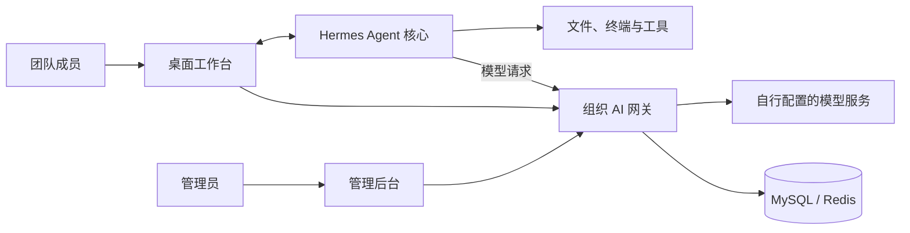

# LLANO Agent

**基于 Hermes Agent 的团队 AI 工作台：统一登录、统一模型接入、按权限使用，并在后台查看用量与审计记录。**

LLANO Agent 将 [Nous Research / Hermes Agent](https://github.com/NousResearch/hermes-agent) 的 Agent 能力接入一套组织管理体系。员工通过桌面端处理任务，管理员通过后台管理账号、模型、技能和使用规则。

适合希望把 AI 推广给多个部门、又需要统一配置和管理的团队。

> 本项目提供源码，可自行部署桌面端、审计网关和管理后台；模型接口、密钥和外部系统需要自行配置。没有配置模型时，可以查看界面和管理后台，但不能生成 AI 回复。

[与 Hermes 的区别](#与-hermes-有什么区别) · [实际好处](#这些改动有什么实际好处) · [系统结构](#系统怎么运行) · [部署说明](audit-gateway/server/DEPLOY.md) · [仓库内容](#仓库内容)

## 与 Hermes 有什么区别？

Hermes Agent 提供了本项目的核心基础，包括模型调用、工具执行、技能、记忆、定时任务，以及 CLI、TUI、桌面端等入口。这些能力来自上游，也继续是 LLANO Agent 的基础。

LLANO Agent 的主要扩展集中在**组织账号、受管理的模型接入和管理后台**。以下比较描述本仓库的产品方向与实现，不是对 Hermes 所有插件、托管服务或未来版本的功能穷举。

| 方面 | Hermes 提供的基础 | LLANO Agent 的扩展与默认方式 |
| --- | --- | --- |
| 使用入口 | CLI、TUI、桌面端等多种入口 | 在桌面端接入组织登录与统一产品配置，面向团队成员使用 |
| 模型接入 | 可配置不同模型供应商与自己的接口 | 品牌桌面端通过组织网关接入，由管理员配置上游模型渠道；普通用户从获授权的模型中选择 |
| 账号与权限 | 提供 Agent 使用与接入能力 | 增加独立的用户、部门、角色体系；模型可按全局、部门、角色或个人授权，无授权默认不可用 |
| 用量与配额 | 支持 Agent 运行及相关会话信息 | 网关集中记录用量，后台按权限查看报表，并可设置用户或部门的模型每日 Token 配额 |
| 会话查看 | 会话历史是 Agent 工作体验的一部分 | 增加网关侧会话留存和按角色授权的审计入口，便于组织内追溯问题 |
| 技能复用 | 技能创建、使用和生态是 Hermes 的核心能力 | 增加组织技能库的发布、分发、归属和使用统计，支持团队共享工作方法 |
| 统一规则 | 可配置 Agent 的人格与行为 | 后台提供组织提示词策略的草稿、发布、版本记录和回滚 |
| 部署维护 | 可按个人或开发者需求选择运行方式 | 需要额外维护审计网关、管理后台、MySQL 和 Redis，并管理自己的组织配置 |

**选择建议：**个人使用、自由切换供应商或优先跟进上游新功能，可先看 Hermes；需要给多个部门分配账号、模型权限和配额，并集中运营使用情况，可以评估 LLANO Agent。

## 这些改动有什么实际好处？

### 1. 员工少做模型配置，管理员集中维护

管理员配置模型渠道、密钥和授权后，员工使用组织账号登录，从可用模型中选择。上游模型密钥由网关持有，桌面端使用系统签发的设备凭据。

例如更换一个模型渠道，可以在后台调整配置，减少逐台电脑修改上游接口和密钥的工作。业务工具所需的个人凭据仍需按相应工具的要求配置。

### 2. 不同岗位可以使用不同的模型

模型白名单支持按部门、角色和个人分配。团队可以根据任务需要，给不同成员开通不同的模型，而不是把所有渠道都开放给每个人。

例如为日常文案开放常用模型，为研发任务额外开放更高能力的模型。具体模型质量、价格和授权范围由部署方决定。

### 3. 看得到用量，也能设置使用额度

后台集中展示用量，支持按用户、部门和模型查看相关数据；每日 Token 配额用于限制相应用户或部门对模型的使用。

这有助于回答“哪个部门用得多”“某个模型是否值得继续采购”等问题。**费用展示属于估算，不能替代模型供应商账单；本项目没有承诺固定比例的成本节省。**

### 4. 一个同事做好的技能，可以供团队复用

在 Hermes 技能机制之上，组织技能库提供发布、分发和使用统计。团队可以把整理报表、资料归纳等可重复的工作方法整理成技能，供其他成员安装使用。

共享技能能减少重复整理流程的工作，但不会自动授予业务系统权限；使用者仍需具备相应的数据访问权限。

### 5. 团队规则可以统一发布，问题可以追溯

管理员可以发布组织提示词策略，并通过版本记录查看和回滚变更。获授权的审计角色可以查看网关留存的会话，帮助排查调用失败、异常输出和使用问题。

**审计意味着会话内容可能被组织管理员或审计人员查看。**部署方应向使用者说明记录范围、访问权限和保留方式。

## 系统怎么运行？

- **桌面端**：提供会话、技能、工具和项目协作入口，连接 Hermes 核心及组织网关。
- **Hermes 核心**：执行 Agent 任务。在本地运行模式下，文件和终端等工具运行在使用者电脑上；远程模式由相应后端执行。
- **组织网关**：处理身份认证、模型授权、转发、配额、用量记录和会话审计。
- **管理后台**：供管理员配置账号、部门、模型、技能、MCP 和提示词策略等。

本机部署不等于完全离线：模型请求会发送到你配置的模型服务，工具也可能访问外部系统。网关的审计与脱敏覆盖其处理的请求，不能视为整台电脑的网络隔离或全部工具操作的审计保证。

## 如何运行？

完整步骤见 **[本地部署说明](audit-gateway/server/DEPLOY.md)**。

1. 准备 Python 3.11–3.13、Node.js >=22.22、npm、uv、MySQL 和 Redis。
2. 创建独立数据库，按 `.env.example` 配置网关密钥与连接信息。
3. 安装网关依赖、构建管理后台，启动审计网关。
4. 打开 `http://127.0.0.1:7899/`，使用首次启动生成的管理员账号登录。
5. 启动桌面客户端；需要真实对话时，再配置模型渠道、模型和白名单。

初始管理员用户名为 `admin`，密码首次启动时随机生成并在日志中显示一次。**管理员身份不自动获得模型使用权限，也需要配置白名单。**

首次体验可以先验证后台和桌面界面，再逐项接入模型、单点登录、业务系统和协作服务。

## 当前状态与使用边界

| 项目 | 当前说明 |
| --- | --- |
| 源码与界面 | 提供桌面端、网关、管理后台及 Hermes 核心；本次整理已验证本地后台登录与桌面启动 |
| 真实模型对话 | 需要自己的模型接口、密钥和授权；本次本地验证未进行真实模型对话测试 |
| 钉钉、业务系统、项目仓库等集成 | 仓库包含相关实现，需要自行部署或填写对应配置，不是下载后即可连接的公共服务 |
| Windows / macOS 安装包与自动更新 | 包含构建和更新相关代码；本仓库未提供经过本次验证的发布安装包或可直接使用的更新服务 |
| 自由度 | 品牌桌面端默认限制自行配置供应商、部分 OAuth、消息平台等入口，以执行组织统一策略；具体见 [产品配置](apps/desktop/product-environments.json) |
| 运维 | 需要维护数据库、缓存、网关、备份和权限配置；公开源码不代表完成生产安全评估或获得合规认证 |
| 上游更新 | 当前为一次性源码快照，不会自动同步 Hermes 或原 Gitee 仓库的新变更 |

## 仓库内容

本仓库于 **2026-10-24** 从源码归档建立，不含原 Gitee 提交历史。

- 保留程序源码、测试、通用文档、许可证和贡献者信息。
- 不包含环境密钥、本机账号文件、会话数据、数据库、运行日志或依赖安装目录。
- 内部服务地址、部署标识和初始组织数据已替换为示例配置；公司提示词策略替换为通用模板。
- 移除了内部开发记录、演示材料、正式更新清单和特定生产部署脚本。
- `*.example.invalid` 是不可用占位地址。更新签名公钥也是占位值，部署方必须生成自己的密钥；测试向量中的固定密钥不可用于发布。
- 继承的 CI/CD 工作流存放在 `.github/workflow-templates/upstream/*.disabled`，默认不执行。

## 代码入口

| 目录 | 用途 |
| --- | --- |
| [`apps/desktop`](apps/desktop) | Electron / React 桌面客户端 |
| [`audit-gateway/server`](audit-gateway/server) | Python / FastAPI 审计网关 |
| [`audit-gateway/client`](audit-gateway/client) | Vue 管理后台 |
| [`agent`](agent)、[`hermes_cli`](hermes_cli) | Agent 核心与运行入口 |
| [`tools`](tools)、[`skills`](skills)、[`plugins`](plugins) | 工具、技能和插件 |

想核对具体实现，可以从 [模型授权](audit-gateway/server/services/model_access.py)、[角色权限](audit-gateway/server/services/permissions.py)、[每日配额](audit-gateway/server/services/quota.py)、[组织技能库](audit-gateway/server/services/skill_hub.py) 和 [提示词策略](audit-gateway/server/services/prompt_policy.py) 开始。

## 来源与许可证

LLANO Agent 基于 [Nous Research / Hermes Agent](https://github.com/NousResearch/hermes-agent) 开发。Agent 核心、技能与记忆等基础能力，以及大量客户端和工具实现，来自 Hermes 与其贡献者。上游介绍保留在 [README.upstream.md](README.upstream.md)。

保留 [MIT 许可证](LICENSE)、Nous Research 版权声明、贡献者文件及各子目录许可证。此仓库为独立整理的公开版本，不代表 Hermes 上游或任何公司的官方背书。
